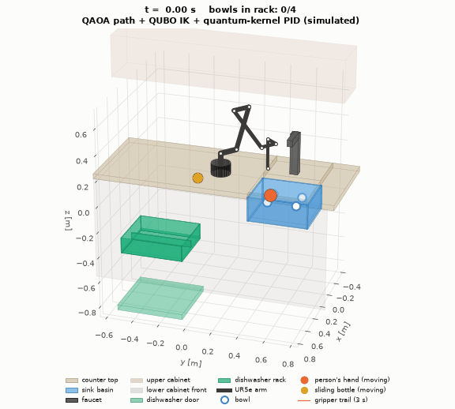
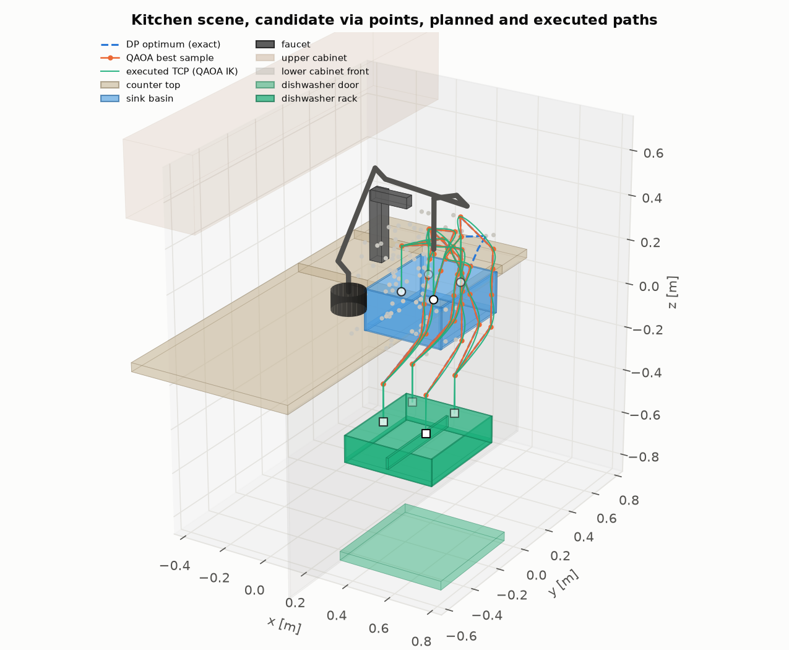
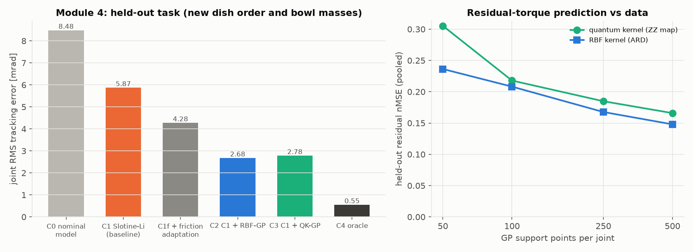
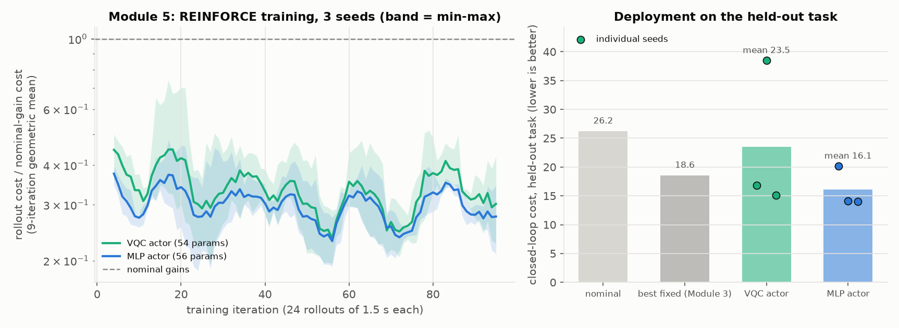
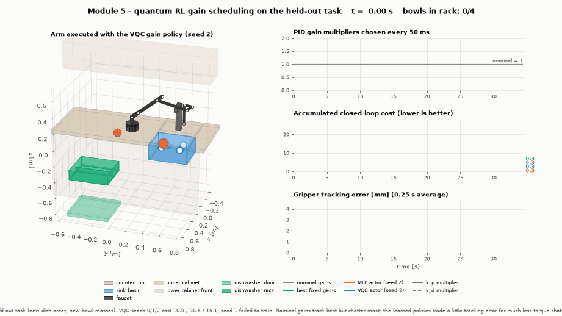
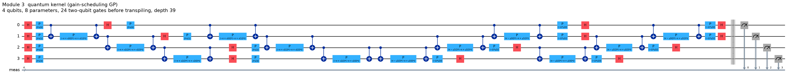
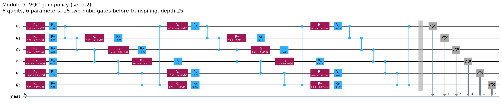

# Quantum-assisted dish loading with a UR5e

**Qiskit Fall Fest @ UCSD, Track 5 (open track).** A simulated 6-DOF UR5e moves four bowls
from a sink into a dishwasher rack. The kitchen has fixed obstacles (faucet, sink walls,
upper cabinet, counter edge, rack) and two moving ones: a person's hand reaching toward
the sink and a bottle sliding along the counter. Each of five modules is formulated for a
quantum algorithm, run in Qiskit, and compared with an exact or classical baseline:

| Module | Quantum formulation | Qubits | Baseline |
|---|---|---|---|
| 1. End-effector path | QAOA on a binary-encoded HUBO (via-point choice per layer) | 10 | exact dynamic programming + brute force |
| 2. Inverse kinematics every 0.01 s | QAOA-sampled QUBO with transferred angles, exact re-ranking | 10 per round, 2 rounds per step | damped least squares; bounded least squares on the same objective; brute-force QUBO |
| 3. PID gain update every 0.01 s | Gaussian process with a quantum fidelity kernel (ZZ feature map) | 4 | nominal gains; best fixed gains; RBF-kernel GP |
| 4. Residual-dynamics learning | Quantum-kernel GP (ZZ feature map, per-feature bandwidths) on top of Slotine–Li adaptive control | 4 | Slotine–Li adaptive control; ARD-RBF GP |
| 5. Gain-schedule policy | REINFORCE with a variational quantum circuit actor (data re-uploading) | 6 | fixed gains; MLP actor |

### Algorithms used

| Category | Algorithm | Where |
|---|---|---|
| Quantum optimisation | QAOA (p = 1–4) on HUBO/QUBO, parameter transfer across instances, INTERP initialisation, CVaR objective | Modules 1, 2 |
| Quantum kernels | Fidelity kernel of the ZZ feature map, bandwidth scaling, ARD-style per-feature bandwidths, depth selection by marginal likelihood | Modules 3, 4 |
| Quantum ML | Variational quantum circuit (data re-uploading), parameter-shift gradients | Module 5 |
| Classical learning | Gaussian process regression, ARD-RBF kernel, REINFORCE with a per-decision baseline, Gaussian policy, MLP actor | Modules 3–5 |
| Control | PID at 500 Hz with gain scheduling, Slotine–Li adaptive control (payload and friction adaptation), computed-torque feedforward | Modules 3–5 |
| Planning and kinematics | Exact dynamic programming, brute-force enumeration, damped least-squares IK, bounded least-squares IK, capsule collision model, UR5e DH kinematics and rigid-body dynamics | Modules 1–4 |
| Hardware execution | Qiskit SamplerV2 with parameter-sweep PUBs, batch mode, transpilation to Heron, FakeFez noise model | all |

### Links

* **Presentation video:** [YouTube](https://youtu.be/UP2QvYcpZn0) 
* **Quantum circuits:** [figures/circuits/Circuit_README.md](figures/circuits/Circuit_README.md): all seven circuits, their gate counts and their results on ibm_marrakesh
* **IBM hardware run:** [results/hardware_summary.md](results/hardware_summary.md): job IDs, QPU time and the ideal vs noisy vs hardware comparison





## The question

Can near-term quantum optimisation and quantum kernels do useful work in a manipulator's
planning and control stack, and how does each piece compare with what a classical
method does on the same problem?

Short answer from this project: all three quantum pieces work and are validated against
exact answers. None beats its classical baseline. The reasons, and what it would take
to change that, are in [Result analysis](#result-analysis). In Modules 4–5, the quantum
learners beat the classical controllers (Slotine–Li adaptive control, fixed gains), but
they only match classical learners of the same kind (an RBF-kernel GP, an MLP policy).

## Results (exact/ideal simulation, full four-bowl task, 34.4 s, 3,441 steps of 0.01 s)

### Module 1: QAOA path planning
Each transfer or return leg has 5 layers × 4 candidate via points (2 qubits per layer,
binary-encoded, so **every bitstring is a valid path and there are no penalty terms**).
Costs: arm-body clearance at each via point (IK + capsule model, with the moving obstacles
placed where they will be when the arm gets there), Cartesian length, joint travel, swept-volume
clearance between via points. Terms are up to 4-local and only couple neighbouring layers, so
the circuit is a 1-D chain.

| | value |
|---|---|
| legs where the best of 2,048 QAOA samples = DP optimum | **6 / 7** (the miss is 1.8 % above optimum) |
| mean P(sample = optimum), p = 1 / 2 / 3 / 4 | 0.0053 / 0.0128 / 0.0159 / 0.0208 |
| uniform random P(optimum) | 0.00098 |

### Module 2: per-step IK as a QUBO
q_next = q + v + Δ (a constant-velocity prediction plus a correction). Δ for joints 1–5 uses
2 qubits per joint, Δᵢ = δ(2x₁ + x₀ − 1.5), refined over 2 rounds with δ/4, giving 16 levels per
joint. Joint 6 is frozen because with a down-pointing, axisymmetric gripper it affects neither
the task nor any clearance, which saves 2 qubits. The linearised objective is a sum of squares, so
it is exactly a QUBO. It combines tolerance-weighted tracking (loose in transit, tight at
grasp/place: the arm may leave the nominal path when that buys clearance), smoothness, minimum
joint turning, a comfort zone, and linearised clearance to every obstacle. The sampled bitstrings
are re-ranked with exact forward kinematics and collision checks.

QAOA angles are trained once on 120 instances and **transferred** to all others
(parameter concentration, Shaydulin et al.). Held-out test on 400 QUBOs:

| | p=1 | p=2 | p=3 | uniform |
|---|---|---|---|---|
| P(optimum) | 0.0044 | 0.0083 | 0.0127 | 0.0010 |
| optimum in top-6 of 256 shots | 0.64 | 0.85 | 0.92 | 0.23 |

Closed IK loop over the whole task (6,880 QUBOs solved):

| solver | TCP RMS / max error | min clearance | steps in collision | weighted joint travel |
|---|---|---|---|---|
| DLS, tracking only | 4.5 / 32.5 mm | **−29.8 mm** | 124 | 43.3 |
| bounded LSQ, same objective | 0.68 / 6.9 mm | 7.5 mm | 0 | 40.0 |
| brute-force QUBO | 0.68 / 6.3 mm | 8.1 mm | 0 | 40.6 |
| **QAOA QUBO (p=3, 256 shots)** | 0.68 / 6.3 mm | 8.2 mm | 0 | 40.4 |

QAOA picked the exact grid optimum in 92.5 % of steps. Bowl tilt while carrying stays ≤ 8.4°.
The naive tracker drives the elbow into the sliding bottle at t ≈ 33 s. The clearance-aware
formulations step around it ([figure](figures/fig3_ik.png)).

### Module 3: quantum-kernel GP gain scheduling
Plant: UR5e rigid-body dynamics (published masses and COMs), reflected rotor inertia,
friction, torque limits, encoder noise, a 2 ms actuation delay, and a bowl payload
(0.45–0.95 kg) that the gravity model does not know about. PID runs at 500 Hz. Gain multipliers
(k_p, k_d) are updated every 0.01 s from features of the motion (wrist reach, speed,
acceleration, payload flag). Labels come from 1.5 s closed-loop rollouts over a 5×4 gain grid
(cost = tracking error + torque chatter + saturation). A safe set excludes any gain pair that
diverged or cost more than 5× the optimum in any training window. Training uses the first half
of the task and testing the second half.

| controller | closed-loop cost | joint RMS error | TCP max error | min clearance during execution |
|---|---|---|---|---|
| nominal fixed gains | 25.9 | 0.57 mrad | 5.3 mm | 7.0 mm |
| best fixed gains (k_p=1.0, k_d=0.4) | 17.3 | 1.12 mrad | 14.0 mm | 4.4 mm |
| RBF-kernel GP schedule | **17.2** | 1.12 mrad | 14.0 mm | 4.3 mm |
| quantum-kernel GP schedule | 19.3 | 1.11 mrad | 14.3 mm | 4.5 mm |

Held-out regression RMSE (log gains): QK-GP 0.369, RBF-GP 0.260, predicting the training mean
0.248. The features explain little of the variation in the optimal gains, so neither kernel can
beat a well-chosen constant. The quantum kernel needed bandwidth tuning (selected α = 0.3 by
marginal likelihood) to avoid the concentration problem.

## Quantum learning methods (Modules 4–5)

Both modules compare the quantum learner with a classical controller and with a classical
learner of the same kind. Training uses the task above. **Testing uses a held-out task**:
the dishes are collected in a different order (new paths, planned with DP and solved with
least-squares IK), with different bowl masses (0.90 / 0.35 / 1.10 / 0.55 kg instead of
0.45 / 0.80 / 0.60 / 0.95 kg) and a different noise seed. Run with
`python scripts/run_learning.py`.

### Module 4: Slotine–Li adaptive control + quantum-kernel GP residual dynamics
The plant contains effects the controller's model does not: viscous and Coulomb friction,
cable drag (a spring on joints 1–3), gear ripple, rotor inertia 20 % above the model, and
the unknown bowl. The **Slotine–Li adaptive controller** adapts the bowl mass online; a
variant also adapts 12 friction coefficients. On top of it, a GP learns the torque that is
still left over: one Gaussian
process per joint on (sin q, cos q, q̇, q̈). It is trained from one logged run of the
baseline and added as feedforward. The quantum kernel is the fidelity kernel of Qiskit's
ZZ feature map (4 qubits). Its per-feature bandwidths (the quantum analogue of ARD length
scales), amplitude, noise and feature-map depth are all chosen by marginal likelihood. The
classical learner is an ARD-RBF GP with the same data and support set (250 points per
joint).

| controller (held-out task) | joint RMS error | TCP RMS / max error |
|---|---|---|
| C0 nominal model, no adaptation | 8.48 mrad | 5.98 / 13.3 mm |
| **C1 Slotine–Li, payload (baseline)** | 5.87 mrad | 4.53 / 8.5 mm |
| C1f Slotine–Li, payload + friction | 4.28 mrad | 3.64 / 7.0 mm |
| C2 C1 + RBF-kernel GP residual | **2.68 mrad** | 1.82 / 7.0 mm |
| **C3 C1 + quantum-kernel GP residual** | 2.78 mrad | 1.88 / **6.8 mm** |
| C4 oracle (true model) | 0.55 mrad | 0.77 / 4.3 mm |

* **Residual learning works:** the quantum-kernel GP cuts the baseline's joint error by
  53 % and beats the friction-adapting law. Because its regressor is incomplete, the
  adaptive law also biases the mass estimate: a mean error of 0.40 kg for C1, against
  0.27 kg once the residual is learned.
* **Quantum kernel ≈ RBF kernel:** closed-loop error is within 4 %. Held-out residual
  prediction is slightly worse for the quantum kernel at every data size (pooled nMSE
  0.31 / 0.22 / 0.18 / 0.17 vs 0.24 / 0.21 / 0.17 / 0.15 for 50 / 100 / 250 / 500 points).
  The learned bandwidths switch off features a joint does not need (for example joint 1
  ignores acceleration), as ARD length scales do.
* **Noise:** the joint-1 kernel circuit (3 feature-map layers, 34 CZ on Fez) has mean
  absolute error 0.062 on the Fez noise model, against 0.008 from shot noise alone; mean
  kernel entry is 0.47. That is nearly four times the error of the Module 3 kernel, so depth
  selection should trade likelihood against circuit noise before a hardware run.
* **Both GPs have rare spikes:** their peak joint error (28–31 mrad) is higher than C1f's
  (18 mrad), but TCP peak error is lower. Variance gating of the residual is the obvious
  next step.



### Module 5: policy-gradient RL with a variational quantum circuit actor
Module 3 learned gains from short-window labels and could not beat a fixed gain. Here the
gain schedule is learned **directly on the multi-step closed-loop cost** with REINFORCE
and a per-decision baseline. Every 50 ms the agent sees the motion features
plus its measured tracking error and error rate, and outputs (k_p, k_d) multipliers
through a Gaussian policy; gain changes are smoothed with a 0.1 s time constant. The
**quantum actor** is a 6-qubit data re-uploading circuit (3 layers, 54 angles, exact
parameter-shift gradients). The **classical actor** is a 6-6-2 tanh MLP with 56
parameters. Both start from the same centred policy and get the same windows, batch size
(24 rollouts of 1.5 s per iteration), iteration count and seeds.

Held-out task, closed-loop cost (tracking error + effort + torque chatter + saturation; lower is better):

| controller | seed 0 | seed 1 | seed 2 | mean ± std |
|---|---|---|---|---|
| nominal gains | – | – | – | 26.3 |
| best fixed gains from Module 3 | – | – | – | 18.6 |
| **VQC actor** (54 params) | 16.8 | 38.5 | 15.1 | 23.5 ± 10.6 |
| MLP actor (56 params) | 20.2 | 14.1 | 14.0 | 16.1 ± 2.9 |

* **RL fixes Module 3's main problem:** optimising the real multi-step cost beat the best
  fixed gains in 4 of 6 runs (2 of 3 for each actor). The best runs cut cost by 46 % against
  nominal gains and 25 % against the best fixed gains, with lower tracking error than the
  best fixed gains (0.85–1.04 mrad against 1.15 mrad).
* **The quantum actor matches the classical one when it trains, but is less reliable.**
  Two VQC seeds land at 15.1 and 16.8, close to the MLP's 14.0–14.1. One VQC seed failed:
  its training curve never improved and it costs 38.5 on the held-out task. With equal
  budgets the circuit actor learned more slowly in 2 of 3 seeds (geometric-mean rollout cost
  over the last 20 iterations: 0.31–0.39 of nominal for the VQC, 0.29–0.34 for the MLP).
* **Safety caveat:** every learned or tuned gain schedule trades accuracy for smoothness, and
  executed clearance drops from 6.3 mm with nominal gains to 2.4–4.5 mm. The next version of
  the reward should penalise lost clearance, not only tracking error.
* **Noise:** running the trained circuit (seed 2) on the Fez noise model changes its gain
  outputs by 5.6 % on average (1.1 % from shot noise alone). The circuit has 6 qubits and 18 CZ gates in its
  ring (56 two-qubit gates once mapped onto Fez's heavy-hex layout), so it is still
  shallow enough for hardware.

* **The policies really schedule.** The VQC keeps k_p near 0.9 and k_d near 0.3, and raises
  k_d briefly around grasp and release; the MLP also raises k_p while carrying. Holding each
  policy's time-averaged gains constant instead costs 28.4 (VQC seed 2) and 29.1 (MLP seed 2)
  against 15.1 and 14.0 when scheduling, so the short bumps carry most of the gain.



The animation below replays the held-out task with the VQC policy driving the simulated arm;
the panels show the gains it picks, the accumulated cost of each controller and the gripper
tracking error. Nominal gains track best but chatter most, so they end with the highest cost.



## The quantum circuits

All seven circuits are drawn in [`figures/circuits/`](figures/circuits/) (PNG, one PDF and text);
[Circuit_README.md](figures/circuits/Circuit_README.md) describes each one with its hardware result.
`python scripts/draw_circuits.py` regenerates them locally; it needs no IBM account and uses no
quantum time.

| Circuit | Qubits | Parameters | Two-qubit gates (as written) | Two-qubit gates on ibm_marrakesh | Instances run |
|---|---|---|---|---|---|
| [Module 1 path planning, QAOA p=1](figures/circuits/m1_p1.png) | 10 | 52 | 109 | 202 | 7 |
| [Module 1 path planning, QAOA p=3](figures/circuits/m1_p3.png) | 10 | 156 | 327 | 675 | 7 |
| [Module 2 inverse kinematics, QAOA p=1](figures/circuits/m2_p1.png) | 10 | 56 | 45 | 166 | 40 |
| [Module 2 inverse kinematics, QAOA p=3](figures/circuits/m2_p3.png) | 10 | 168 | 135 | 508 | 40 |
| [Module 3 quantum kernel](figures/circuits/m3_kernel.png) | 4 | 8 | 24 | 22 | 248 |
| [Module 4 quantum kernel](figures/circuits/m4_kernel.png) | 4 | 8 | 36 | 34 | 248 |
| [Module 5 policy circuit](figures/circuits/m5_policy.png) | 6 | 6 | 18 | 56 | 40 |

**QUBO and QAOA.** A QUBO (quadratic unconstrained binary optimisation) is the *problem*: a cost
over bits with one- and two-bit terms. QAOA is the quantum *algorithm* that samples low-cost
bitstrings of it. Module 2 writes each inverse-kinematics step as a QUBO and solves it with QAOA;
Module 1 does the same with a HUBO, which also has three- and four-bit terms.

The quantum kernel (Module 3): the ZZ feature map of one robot state, then the inverse feature map
of another. The probability of measuring 0000 is their similarity.



The gain policy (Module 5): three layers of input-dependent RY rotations, RZ rotations and a ring
of CZ gates. Two measured qubits set the two controller gains.



## Validation: ideal vs noisy vs hardware

* `tests/test_validation.py` (9 tests, all pass): the fast NumPy QAOA simulator equals Qiskit
  `Statevector` to 1e-9 (including 6-local terms); the Walsh expansion is exact; DP equals brute
  force on a real leg; the Jacobian matches finite differences; the gravity torque equals the
  gradient of potential energy; the compute-uncompute kernel circuit equals the statevector
  fidelity; the fast ZZ-kernel and VQC simulators equal Qiskit `Statevector` and the
  parameter-shift gradient equals finite differences; the Slotine–Li model terms and payload
  regressor match the rigid-body dynamics.
* `main.py` builds every quantum circuit of the project in Qiskit, checks each one against
  Qiskit's exact `Statevector`, the fast simulator used in the control loop and (for QAOA)
  Qiskit's own `QAOAAnsatz` (agreement to better than 1e-10), transpiles it for the backend and runs each
  module as **one Runtime Sampler PUB with a parameter sweep** (one transpiled circuit for all
  instances). The same command runs on ideal Aer, on a noisy fake backend and on an IBM QPU.

| | exact | ideal Aer (1,024 shots) | noisy FakeFez (Heron noise model) | IBM ibm_marrakesh (1,024 shots) | uniform |
|---|---|---|---|---|---|
| M1 P(opt), p=1 | 0.0053 | 0.0049 | 0.0042 | 0.0027 | 0.0010 |
| M1 P(opt), p=3 | 0.0155 | 0.0163 | 0.0043 | 0.0010 | 0.0010 |
| M2 P(opt), p=1 | 0.0045 | 0.0040 | 0.0029 | 0.0017 | 0.0010 |
| M2 P(opt), p=3 | 0.0132 | 0.0138 | 0.0045 | 0.0032 | 0.0010 |
| M3 kernel MAE | 0 | 0.007 | 0.017 | 0.024 | – |
| M4 kernel MAE | 0 | 0.008 | 0.062 | 0.105 | – |
| M5 gain error | 0 | 1.1 % | 5.6 % | 15.1 % | – |

The IBM column comes from `python main.py` on ibm_marrakesh (2026-11-16, 189 s of QPU time, no
error mitigation); job IDs and per-module details are in
[results/hardware_summary.md](results/hardware_summary.md) (see also [below](#on-your-ibm-quantum-account)).
Instances: 7 path legs, 40 IK QUBOs, 248 kernel entries per kernel, 40 policy observations.
Two-qubit gates after transpiling to Fez's heavy-hex layout: M1 202 (p=1) / 675 (p=3); M2 166 / 508;
kernels 22 (M3) and 34 (M4); policy 56. **Under noise, p=3 loses 60–70 % of its ideal P(opt)**:
it ends level with p=1 on Module 1 at three times the gate count, and keeps only a small edge on
Module 2. By mean cost (approximation ratio) p=1 is as good or better: 0.83 vs 0.76 on Module 1,
0.85 vs 0.85 on Module 2. The kernel survives noise: GP accuracy is unchanged (RMSE 0.326 with
the exact kernel, 0.319 with the noisy one).

Caveat: with 10 qubits and 1,024 shots, "optimum in top-6" is close to 1 even for uniform
sampling, so P(opt) and the approximation ratio are the meaningful metrics at this size.

## Result analysis

**Where it works.** The binary (non one-hot) path encoding gives every sample a valid path and
maps to a 1-D chain, which is friendly to heavy-hex hardware. Parameter transfer removes all
per-step classical optimisation from the 100 Hz loop. Sampling plus exact re-ranking means
linearisation error and hardware noise can only cost optimality, never safety.

**Where it fails, and why.**
1. *Module 1 is classically easy.* A chain-structured cost is solved exactly by DP in
   microseconds. QAOA here is a correct demonstration, not an advantage.
2. *Module 2 is locally convex.* Once linearised, per-step IK is a box-constrained least-squares
   problem: bounded LSQ solves it in under 3 ms with the same results. The QUBO only adds
   discretisation.
3. *A QPU cannot sit in a 100 Hz loop.* Cloud job latency is seconds to minutes and each step
   depends on the previous one, so hardware can only replay batches of recorded instances (which
   is what `main.py` does), not close the loop.
4. *Module 3 has nothing to learn here.* The optimal gains vary weakly with the available
   features. The quantum kernel matches, but does not beat, the RBF kernel or a constant.
   Lower-damping gains also cut the executed clearance from 7 mm to about 4.4 mm: the
   cost weights trade accuracy for smoothness, and that trade is a design choice.

**What it would take to scale.** Problems that are combinatorial rather than chain-structured:
multi-dish sequencing and slot assignment (TSP/QAP-like), or global IK branch selection across
keyframes. Use warm-started QAOA (Egger et al.) with constraint-preserving mixers. Use
shallow-depth hardware runs with error mitigation (twirling, dynamical decoupling). Keep the
quantum work offline (planning, gain-table generation) and the 100 Hz loop classical.

## What I learned
* A formulation that is exact (QUBO/HUBO from a Walsh transform) and checkable by brute force
  turns a vague "quantum robotics" pitch into numbers anyone can verify.
* Under realistic noise, depth is the enemy: p=3 loses most of its ideal advantage over p=1.
* Short-horizon controller labels are myopic. 0.6 s windows chose gains that were unstable over
  a 34 s task. The safe set and 1.5 s windows fixed that.
* Quantum kernels need bandwidth tuning, and should be judged against a tuned classical kernel
  and a constant predictor.

## Next steps

### 1. Test on the lab hardware (highest priority)
Everything above is simulation. The next milestone is running the pipeline on a real arm in the lab.

* **Split by timing.** QAOA path planning (Module 1) and gain-schedule / residual-model
  training (Modules 3–5) run offline, before the task. The 500 Hz joint loop stays classical
  on the robot controller and only reads the learned gain table and residual GP.
* **Sim-to-real first.** Identify friction, payload and delay on the real arm, refit the
  Module 4 residual GP from a logged run, and compare tracking error against the simulated
  numbers. If the lab arm is not a UR5e, swap in its DH parameters and link masses.
* **Perception.** Replace the scripted hand and bottle with tracked obstacles (depth
  camera), so Module 1 and 2 clearance terms use measured, not predicted, positions.
* **Safety.** Start with reduced speed and a light plastic bowl, keep the classical IK as a
  fallback, and add a clearance term to the RL reward before deploying a learned schedule
  (Module 5 lost 2–4 mm of clearance in simulation).
* **IBM QPU runs.** Run `python main.py` alongside the lab tests so
  every module has ideal, noisy and real-QPU numbers.

### 2. Mobile manipulation: dining table to dishwasher
Mount the arm on a wheeled base so it can clear a dining table and carry dishes to the
dishwasher.

* **Base motion planning.** Plan the base in SE(2) around chairs, table legs and people
  (A* / RRT* baseline with a kinematic car model), then hand over to the arm planner at the
  table and at the dishwasher.
* **Where quantum fits.** The combinatorial part is new: which dishes to pick from which
  base pose, how many to stack per trip, and in what order (a capacitated routing /
  set-cover problem). Formulate it as a QUBO and compare QAOA with an exact MIP / CP-SAT
  solver, as Module 1 does with DP.
* **Whole-body IK.** Extend Module 2 to base + arm (9 DOF): base placement is chosen
  offline, arm IK stays per step.

### 3. Test where quantum could actually win
This project found parity, not advantage. These experiments target the conditions where an
advantage is at least plausible:

* **Geometric difference** between the quantum and classical kernels on the Module 4 data
  (Huang et al. 2021). If it is small, no quantum kernel can beat the classical one here.
* **Scale the scheduling problem** (several robots or many dishes sharing rack slots and
  deadlines) and track the QAOA vs CP-SAT/MIP gap as size grows.
* **Trainability of the quantum RL policy:** measure gradient variance against qubit count
  and depth (barren plateaus), and check whether it explains the failed Module 5 seed.
* **Depth vs noise on IBM Heron:** warm-started QAOA with XY mixers, CVaR, twirling and
  dynamical decoupling; find the depth where noise cancels the gain from extra layers.

## Running it

```bash
pip install -U -r requirements.txt
python -m pytest tests -q            # validation checks
python scripts/run_all.py            # Modules 1-3 simulation (~15 min CPU), writes results/
python scripts/run_learning.py       # Modules 4-5 (~35 min CPU), writes results/learning_metrics.json
python scripts/make_figures.py       # figures/ + animation.gif
python scripts/animate_rl.py         # Module 5 animation (figures/animation_rl.gif)
python scripts/draw_circuits.py      # circuit diagrams (figures/circuits/*.png, all_circuits.pdf)
python main.py --backend aer             # every quantum circuit on the ideal simulator (~1 min)
python main.py --backend fake:FakeFez    # same circuits with the ibm_fez noise model (~11 min)
```

`results/` already holds the problem instances, so `main.py` runs without the first two scripts.

### On your IBM Quantum account
`main.py` is the single entry point for the hardware run. It follows IBM's
[hello-world guide](https://quantum.cloud.ibm.com/docs/en/ibm-quantum-compute/hello-world):
save the account once, pick a backend, transpile, run with the Runtime Sampler.

```bash
python main.py --save-account      # once; asks for the API key at a hidden prompt
python main.py --list-backends     # optional: QPUs, live status, queues, your preference order
python main.py --dry-run           # free: build, check, transpile for the QPU, estimate QPU time
python main.py                     # asks for confirmation, submits one batch, waits, analyses
```

* **The key stays out of the repo.** It is stored by Qiskit in `~/.qiskit/qiskit-ibm.json`, or
  read from `QISKIT_IBM_TOKEN` (and optionally `QISKIT_IBM_INSTANCE`). Never paste it into code.
* **One run, no double spending.** Job IDs go to `results/ibm_jobs.json` the moment each job is
  submitted. If the script stops or the queue is long, `python main.py` again picks the same
  jobs up. `--retry` resubmits only jobs that failed or were cancelled; `--new` starts over.
* **Budget.** The Open Plan gives 10 QPU-minutes per rolling 28 days and has no sessions, so
  everything runs in batch mode. The default run is 7 jobs, 630 circuit executions at 1,024
  shots, estimated at about 3.5 QPU-minutes. `main.py` refuses to submit above
  `--budget-seconds` (default 360), compares the estimate with what is left on the instance,
  and caps each job's QPU time. To spend less: `--shots 512`, `--kernel-train 12 --kernel-test 6`
  or `--modules m1,m2,m3`.
* **Backend.** `main.py` uses **ibm_marrakesh**, then **ibm_kingston**, then **ibm_fez**,
  taking the first whose live status is *active* right before submitting (a QPU that is
  paused, in maintenance or offline is skipped). If none of the three is active it falls back
  to the least-busy active QPU and says so before you confirm. If the chosen QPU goes down
  while your jobs are still queued, the script warns you; `python main.py --move` then cancels
  the jobs that have not started (no QPU time is charged for those) and sends them to the next
  active QPU. `--backend ibm:<name>` forces one QPU and `--prefer` changes the order. The QPU
  behind each module is recorded in the results. All three are Heron r2 chips with the same
  layout, and the circuits get identical two-qubit gate counts on each.
* **Options.** `--dd` (dynamical decoupling) and `--twirling` (Pauli twirling) switch on error
  suppression; both are off by default so the first run is the raw device.
* **Circuits.** `python scripts/draw_circuits.py` draws every circuit as PNG and PDF in `figures/circuits/` (local, no QPU time).
* **Output.** Everything from the run is collected in `results/hardware_summary.md`: job IDs,
  the QPU behind each module, QPU seconds used, the ideal / noisy / hardware table and the
  per-module numbers. Alongside it: `results/hardware_ibm.json` (all metrics),
  `results/hardware_ibm_counts.json.gz` (every measured bitstring), `results/ibm_jobs.json`
  (job IDs) and an updated `figures/fig5_hardware.png`. The same jobs and their results are
  also kept on IBM's [Workloads page](https://quantum.cloud.ibm.com/workloads), and any of them
  can be fetched again later with `service.job("<job id>").result()`.

## Layout
```
main.py                all quantum circuits in Qiskit; Aer / noisy / IBM QPU runs (entry point)
qkitchen/robot.py      UR5e kinematics, capsules, rigid-body dynamics (batched)
qkitchen/env.py        kitchen boxes, moving obstacles, clearance functions
qkitchen/qaoa.py       Walsh-exact diagonal problems, fast QAOA simulator, Qiskit circuits
qkitchen/planner.py    Module 1: layered via-point HUBO, DP baseline, min-jerk timing
qkitchen/ik.py         Module 2: per-step QUBO IK and baselines, motion metrics
qkitchen/control.py    Module 3: dynamics sim, PID, labels, quantum kernel, GP
qkitchen/hardware.py   analysis of measured counts (P(opt), kernel values)
qkitchen/qml.py        fast ZZ-kernel and VQC simulators (Qiskit-checked), parameter shift, MLP
qkitchen/learning_control.py  Module 4: Slotine-Li adaptive control, residual GPs, plant
qkitchen/qrl.py        Module 5: REINFORCE with VQC / MLP actors
qkitchen/pipeline.py   task timeline and leg planning
scripts/               run_all, run_learning, make_figures, animate_rl, draw_circuits
```

## Modelling assumptions
UR5e DH and link masses/COMs are from Universal Robots; UR lists link inertias as negligible.
The following are assumptions: reflected rotor inertia, friction, a 0.9 kg gripper with a
0.15 m TCP, capsule radii, bowls modelled as 8 cm spheres, kitchen dimensions, known
trajectories for the moving obstacles (predicted, not sensed), and the cost weights.
Module 4 additionally assumes cable drag (4 / 5 / 2.5 N·m/rad on joints 1–3), gear ripple
(0.1–0.8 N·m, eight cycles per revolution), a rotor inertia 20 % above the model, and an
acceleration estimate with 0.3 rad/s² noise for the logged residuals.

## References
* Egger, Mareček, Woerner, *Warm-starting quantum optimization*, Quantum 5, 479 (2021). arXiv:2009.10095
* Shaydulin et al., *Parameter transfer for QAOA of weighted MaxCut*, ACM TQC (2023). arXiv:2201.11785
* Zhou et al., *QAOA: performance, mechanism, and implementation on near-term devices*, PRX 10, 021067 (2020) (INTERP init)
* Barkoutsos et al., *Improving variational quantum optimization using CVaR*, Quantum 4, 256 (2020)
* Shaydulin & Wild, *Importance of kernel bandwidth in quantum machine learning*, PRA (2022). arXiv:2111.05451
* Thanasilp et al., *Exponential concentration in quantum kernel methods*, Nat. Commun. 15, 5200 (2024). arXiv:2208.11060
* Rapp & Roth, *Quantum Gaussian process regression for Bayesian optimization* (2023). arXiv:2304.12923
* Guo et al., *Benchmarking quantum fidelity kernels for Gaussian process regression*, MLST 5, 035081 (2024). arXiv:2407.15961
* Berkenkamp, Schoellig, Krause, *Safe controller optimization for quadrotors with Gaussian processes*, ICRA 2016. arXiv:1509.01066
* Quantum annealing for robot inverse kinematics (QUBO on D-Wave), Scientific Reports (Dec 2025), doi:10.1038/s41598-025-34346-z
* *Quantum computation for robot posture optimization*, Scientific Reports (2025), doi:10.1038/s41598-025-12109-0
* Rao et al., *A quantum computing approach for multi-robot coverage path planning* (2024). arXiv:2407.08767
* Universal Robots, *DH parameters for calculations of kinematics and dynamics*
* Slotine & Li, *On the adaptive control of robot manipulators*, IJRR 6(3), 49–59 (1987)
* Nguyen-Tuong & Peters, *Model learning for robot control: a survey*, Cognitive Processing 12 (2011)
* Williams, *Simple statistical gradient-following algorithms for connectionist RL* (REINFORCE), Machine Learning 8 (1992)
* Pérez-Salinas et al., *Data re-uploading for a universal quantum classifier*, Quantum 4, 226 (2020)
* Schuld et al., *Evaluating analytic gradients on quantum hardware* (parameter shift), PRA 99, 032331 (2019)
* Jerbi et al., *Parametrized quantum policies for reinforcement learning*, NeurIPS 2021. arXiv:2103.05577
