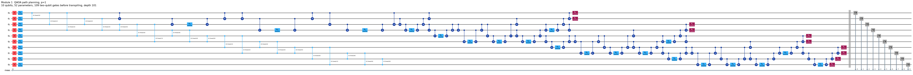
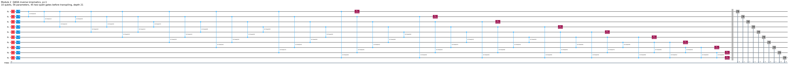
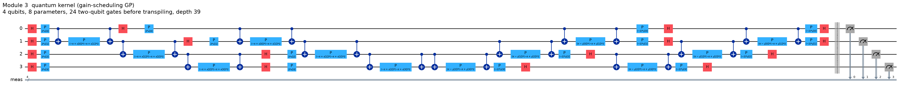
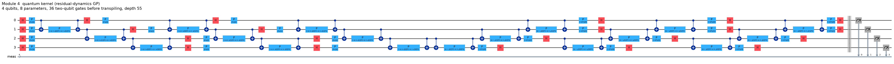
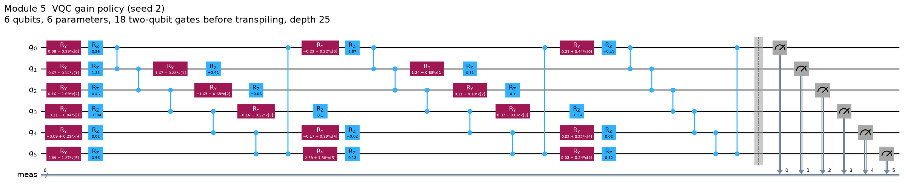

# Quantum circuits

Every quantum circuit of the project, drawn by `python scripts/draw_circuits.py` from the same
functions that `main.py` sends to the QPU. Drawing runs locally and uses no IBM quantum time.
`all_circuits.pdf` has all seven in one file; the `.txt` files are the text versions.

| Circuit | Qubits | Parameters | Two-qubit gates (as written) | Two-qubit gates on ibm_marrakesh | Instances run |
|---|---|---|---|---|---|
| [Module 1 path planning, QAOA p=1](m1_p1.png) | 10 | 52 | 109 | 202 | 7 |
| [Module 1 path planning, QAOA p=3](m1_p3.png) | 10 | 156 | 327 | 675 | 7 |
| [Module 2 inverse kinematics, QAOA p=1](m2_p1.png) | 10 | 56 | 45 | 166 | 40 |
| [Module 2 inverse kinematics, QAOA p=3](m2_p3.png) | 10 | 168 | 135 | 508 | 40 |
| [Module 3 quantum kernel](m3_kernel.png) | 4 | 8 | 24 | 22 | 248 |
| [Module 4 quantum kernel](m4_kernel.png) | 4 | 8 | 36 | 34 | 248 |
| [Module 5 policy circuit](m5_policy.png) | 6 | 6 | 18 | 56 | 40 |

"As written" counts the logical circuit; the hardware column is after transpiling to the
native CZ gates and heavy-hex layout of ibm_marrakesh.

## Result on ibm_marrakesh

All seven circuits ran on 2026-11-16 (1024 shots, no dynamical decoupling, no twirling),
using 189 s of QPU time in total. Full numbers are in
[results/hardware_summary.md](../../results/hardware_summary.md).

| Circuit | Depth on hardware | QPU seconds | Job ID | Hardware result | Ideal (Aer) | Noisy (FakeFez) |
|---|---|---|---|---|---|---|
| m1_p1 | 432 | 4 | `dbtcvkfasvbs73b9je9g` | P(opt) 0.0027 | 0.0049 | 0.0042 |
| m1_p3 | 1178 | 4 | `dbtcvkhvvpic738mqqtg` | P(opt) 0.0010 | 0.0163 | 0.0043 |
| m2_p1 | 296 | 13 | `dbtcvkhvvpic738mqqu0` | P(opt) 0.0017 | 0.0040 | 0.0029 |
| m2_p3 | 750 | 14 | `dbtcvkvq0h0s73bkk860` | P(opt) 0.0032 | 0.0138 | 0.0045 |
| m3_kernel | 98 | 70 | `dbtcvl3eq3sc73evllf0` | kernel MAE 0.024 | 0.007 | 0.017 |
| m4_kernel | 140 | 71 | `dbtcvl7asvbs73b9jeb0` | kernel MAE 0.105 | 0.008 | 0.062 |
| m5_policy | 121 | 13 | `dbtcvl9vvpic738mqqv0` | gain error 15.1 % | 1.1 % | 5.6 % |

Uniform random guessing gives P(opt) 0.0010 for the QAOA circuits. The shallow kernel
circuits survive the hardware best; the deep QAOA p=3 circuits lose most of their advantage
(m1_p3 falls to the uniform level), so depth on hardware, not qubit count, is what limits
the results.

## Module 1 path planning, QAOA p=1

Module 1, path planning. QAOA with 1 layer on the path HUBO: Hadamards, cost layer (RZ, RZZ and CX-ladder terms up to 4 qubits), RX mixer, measurement.

On hardware: P(optimum) 0.0027 (exact 0.0053), approximation ratio 0.795 (exact 0.889); the best sample was the optimum in 6/7 instances.

## Module 1 path planning, QAOA p=3

Module 1, path planning. The same QAOA circuit with 3 layers.

On hardware: P(optimum) 0.0010 (exact 0.0155), the same as uniform guessing; approximation ratio 0.696 (exact 0.915); the best sample was the optimum in 5/7 instances.

## Module 2 inverse kinematics, QAOA p=1

Module 2, inverse kinematics. QAOA with 1 layer on the per-step QUBO: RZ on every qubit, RZZ on every pair, RX mixer.

On hardware: P(optimum) 0.0017 (exact 0.0045), approximation ratio 0.778 (exact 0.873); the best sample was the optimum in 33/40 instances.

## Module 2 inverse kinematics, QAOA p=3

Module 2, inverse kinematics. The same QAOA circuit with 3 layers.

On hardware: P(optimum) 0.0032 (exact 0.0132), approximation ratio 0.805 (exact 0.929); the best sample was the optimum in 40/40 instances.

## Module 3 quantum kernel

Module 3, quantum kernel for gain scheduling. ZZ feature map U(x) followed by U(y)†; P(0000) is the kernel value k(x, y).

On hardware: kernel mean absolute error 0.024, max 0.138 (mean exact entry 0.18). The GP built on the device kernel had error 0.310, against 0.326 with the exact kernel.

## Module 4 quantum kernel

Module 4, quantum kernel for residual dynamics. Same construction with a deeper feature map (depth chosen by marginal likelihood).

On hardware: kernel mean absolute error 0.105, max 0.263 (mean exact entry 0.47); the deeper feature map makes it about four times noisier than Module 3.

## Module 5 policy circuit

Module 5, gain policy. Data re-uploading circuit: RY(w·x + b), RZ and a ring of CZ gates per layer; <Z0> and <Z1> set the two gain multipliers. Trained weights are shown to two decimals.

On hardware: gain error 15.1 % (ideal 1.1 %, noisy simulator 5.6 %); mean absolute error of <Z> 0.190.

